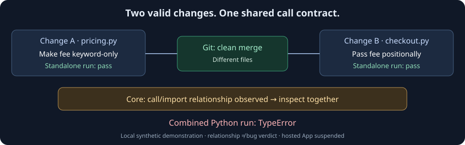

# Veripsa Core

**See when parallel pull requests change related code before they land.**

Veripsa Core began with a practical problem: frequent Git conflicts during
parallel development. Along the way it produced a code graph, historical
co-change analysis, and a persistent coordination runtime. The current work
makes those assets understandable and reproducible, rather than starting a new
hosted service or sales effort.

Git may merge different files cleanly while the combined code stops working.
Core's structural references and historical file relationships supply review
points. Its GitHub App implementation maintains open-PR traffic as work changes;
the same extraction can also be used locally. [Origin and current goal](docs/README.ja.md).

Built by [RollNuts](https://github.com/RollNuts). **[日本語の入口](docs/README.ja.md)**

**Available now:** local analysis, reproducible demos, and source.
**Hosted GitHub App:** intentionally suspended since **2026-08-18**. Installing
the App does not establish working webhook processing; a resumption would need
an explicit announcement. [Current scope](docs/PRODUCT_FACTS.md).



## Start here

| Time | Question | Entry point |
| --- | --- | --- |
| 30 seconds | What problem does this address? | The example above: clean text merge, shared structural contract. |
| 3 minutes | Can I reproduce it without an account or paid API? | [Local structural-overlap demo](examples/structural-overlap/README.md): two valid branches, an actual Git merge, and Core's observed relationship. |
| 10 minutes | What does the evidence mean? | [Architecture and engineering choices](ARCHITECTURE.md), [data boundary](SECURITY.md#content-free-posture), and [pinned Flask history evaluation](docs/OFFLINE_EXAMPLE.md). |

```sh
git clone https://github.com/RollNuts/veripsa.git
cd veripsa
python3.12 examples/structural-overlap/demo.py
```

Requires a POSIX environment with Git and Python 3.12, with no added Python packages, account, database,
model call, or hosted service. The demo creates disposable local repositories;
it does not merge into your checkout. Its JSON report contains relative paths,
relationship evidence, and execution outcomes, not source bodies.

### What the local demo establishes

| Synthetic case | Git merge | Code graph | Co-change | Combined execution |
| --- | --- | --- | --- | --- |
| Function call contract, short history | Clean | Observed | Not observed | TypeError |
| Compatible related changes | Clean | Observed | Observed | Pass |
| Unrelated code, incidentally edited together | Clean | Not observed | Observed | Pass |
| Dynamic lookup, repeated joint edits | Clean | Not observed | Observed | TypeError |

Each branch runs successfully on its own. The first case supplies a structural
review point before enough history exists. Repeated co-edits can supplement a
missed static edge, but they can also describe a batching habit with no runtime
problem. The JSON compares graph/history candidate sets and their union and
intersection; it does not turn correlation into a causal or merge-safety verdict.
It reuses the existing producers, not a new detector. The App's SQL corroboration
policy is separate from this local set comparison.
[Commands, actual output, API/config probes, and limits](examples/structural-overlap/README.md).

### Review a file in your own checkout

From this Core checkout, ask which files to inspect before changing one file:

```sh
python3.12 -B -m tools.review_file /path/to/your/repo src/example.py
```

The local JSON report separates existing static relationship candidates from
historical Co-change partners, and records coverage, thresholds, HEAD, dirty
state, and uncertainty. Python input needs no added packages, database, account,
or model. Candidates guide inspection; they do not predict bugs or approve a
merge. [Try Core itself and read the output](docs/LOCAL_FILE_REVIEW.md).

### Use the existing work

- **Research index:** [architecture, graph, Co-change, evaluation, security research, examples, limitations, and development history](docs/RESEARCH_INDEX.md), with measured evidence separated from unmeasured accuracy and performance.
- **Contribute a result or fix:** [participation guide](CONTRIBUTING.md) and [analysis report form](https://github.com/RollNuts/veripsa/issues/new?template=analysis_report.yml) for incorrect/missed relationships, parser gaps, performance, and reproducible experiments. A minimal reproduction or counterexample is useful without a code change.
- **Analysis inventory and DB choices:** [graph, Co-change, persistence, and tested boundaries](docs/ANALYSIS_ASSETS.md) maps existing functions and compares DB-free use, saved snapshots, and local PostgreSQL.
- **History evaluation:** the [Flask example](docs/OFFLINE_EXAMPLE.md) compares
  structural relationships with past co-change. It measures a different question
  from the synthetic merge demo.
- **AI-agent queries:** the [read-only MCP adapter and Codex example](https://github.com/RollNuts/zenn-content/tree/89fe0fe12258c827a9e7fc54cb12fc96401018de/examples/core-local-mcp)
  live in a separate repository. The adapter reads a fixed snapshot; it is not a
  shipped Core MCP product or an automatic merge controller. The SDK-only path
  is model-free; the optional Codex example uses the user's model allowance.
- **Author and rationale:** [RollNuts](https://github.com/RollNuts) maintains this
  public engineering work. [日本語の背景・発信素材](docs/PUBLISHING_KIT.ja.md)
  records the problem, design decisions, and reproducible findings. Another
  public work, [Mihassei](https://github.com/RollNuts/mihassei-news), explores
  static-site and RSS implementation; its purpose is separate from PR traffic.

The sections below describe the implemented GitHub App contract. Source code
and historical behavior do not establish hosted availability.

---

## What it does

When several open PRs touch related code, the hard problem is not only whether
one PR is correct. It is whether another open PR changes the assumptions around
it, whether landing order matters, and who should wait or revise before `main`
changes.

Git catches textual conflicts at merge time. Per-PR review and CI evaluate an
individual change. Veripsa Core surfaces direct overlap and supported structural
relationships **between open pull requests** as a GitHub check and, when there is
traffic worth briefing, a managed PR comment.

By default the output is advisory: GitHub branch protection or rulesets decide
whether an `action_required` check conclusion holds a merge, and required checks
on private repositories depend on the applicable GitHub plan.

### Traffic signals

Veripsa Core has four base traffic signals:

- **Clear** — no blocking traffic is visible in the analyzed comparison set.
  Clear is not merge approval, correctness, or safety proof.
- **Heads up** — a relationship is worth reviewing. It is normally advisory and
  acknowledgement-free.
- **Wait in line** — strong overlap or landing-order risk is visible; Veripsa
  suggests that this PR wait behind related work.
- **Unknown** — input, coverage, or comparison context is insufficient for a
  supported call. Unknown is not Clear.

A material coupling can add **Paused (acknowledge to proceed)** as an
`action_required` control overlay. Paused is not a fifth traffic verdict. Adding
the `veripsa-ack` label records that a human saw the current coupling snapshot
and chose to proceed. It is not approval, conflict resolution, a permanent mute,
or a claim that the code is correct. A material change to the related work can
make the acknowledgement stale and pause again.

### What the check looks like

When two open PRs touch the same area, the leading PR's comment reads roughly
like this — content-free, carrying only paths, PR references, and landing order,
never file bodies:

```text
### Veripsa — heading to `main`
**✓ Clear — nothing is blocking you**

This PR reserves: `orders/pricing.py`, `tests/test_pricing.py`

> ⏳ 1 in-flight PR is waiting behind this one on `orders/pricing.py`, `tests/test_pricing.py`.

**Overlapping PRs** — 2 open PRs touch this same area.
Suggested order to land:
1. this PR
2. the other open PR on the same area
```

The PR waiting behind renders **Wait in line**, naming the PR ahead of it. A
clean PR with no related traffic is check-only, with no comment.

---

## Where it fits

Veripsa Core works alongside the tools already in the merge path:

- **Merge queues** serialize ready pull requests near final merge time.
- **AI code reviewers** inspect the implementation inside one pull request.
- **CI and tests** validate an individual change and the policies encoded by the
  repository.
- **Veripsa Core** adds the earlier open-PR relationship and landing-order
  signal before those changes land together.

Veripsa may read file contents transiently to extract the structure needed for a
signal. It does not store or display customer source file bodies or diff
contents, and it does not reuse them for code review. The retained surface is
the minimal structural and operational metadata needed to show and audit the PR
traffic decision.

---

## Current scope

- **One repository at a time.** Current coordination is between open pull
  requests within the installed repository and target branch being evaluated.
  Cross-repository coordination is on the [roadmap](./ROADMAP.md), not a shipped
  claim.
- **Language and file coverage.** The unified extractor covers Python,
  JavaScript, TypeScript, Go, Java, Ruby, PHP, C#, Rust, C, C++, and HTML.
  Coverage quality varies by repository shape; Unity-flavoured C# is partial.
  Unsupported or insufficient input resolves to Unknown rather than a guessed
  Clear.

---

## Draft PR policy

Draft PRs receive the same structural analysis as ready PRs. Two presentation
rules keep the scout window useful without weaponising unfinished work:

- **Draft ↔ ready coupling is softened.** The relationship is still shown, but
  the ready side does not receive a material `action_required` escalation solely
  because of an in-flight draft.
- **Draft participants are labelled `(draft)`.** Reviewers can distinguish work
  that is still scouting from work that is trying to land.

The intent is simple: draft is an early window into PR traffic, not a reason to
blind the analysis or to hold ready work unnecessarily.

---

## Hosted service and reference docs

The hosted GitHub App remains suspended. This repository does not currently
provide an active install flow or a hosted-service availability promise. A
future resumption must be announced explicitly with its deployment and data
handling details. The former product domain now serves unrelated content and
is not a product, installation, privacy, or support reference for this snapshot.

For the source snapshot's documented boundaries, see:

- [`docs/PRODUCT_FACTS.md`](./docs/PRODUCT_FACTS.md) — scope, signals, enforcement,
  and historical product posture.
- [`SECURITY.md`](./SECURITY.md) — security reporting, source and metadata
  handling, retention, and supported versions.
- [`SUPPORT.md`](./SUPPORT.md) — support routing and safe report contents.
- [`docs/FIRST_RUN.md`](./docs/FIRST_RUN.md) and
  [`docs/LOW_FRICTION_TRIAL.md`](./docs/LOW_FRICTION_TRIAL.md) — reference behavior
  for a future hosted trial; these documents do not establish current availability.

---

## Offline evaluation

**Want to see the output first?** Follow the
[reproducible Flask example](./docs/OFFLINE_EXAMPLE.md): a pinned public checkout,
standard-library Python, and the observed report measurements. No account token
or GitHub App is needed.

Use **Git and Python 3.12** (the version used by public CI). For a first run on
a Python repository, the evaluator works with the Python standard library;
there is no package installation or GitHub App setup step:

```bash
git clone https://github.com/RollNuts/veripsa.git
cd veripsa
python3.12 -m venv .venv
. .venv/bin/activate
python evaluate.py /path/to/your/repo --out veripsa-report.md
```

The activation command above is for a POSIX shell. Supply a local Git checkout
with its history; the evaluator uses local source structure and `git log`
co-change history. It does not transmit repository contents. Review the report
and console logs before sharing them: they can identify the repository and
local checkout paths.

Python parsing uses the standard library. Non-Python language grammars and
some configuration parsing require optional dependencies; without them,
coverage is reduced. The complete runtime manifest is
[`requirements.txt`](./requirements.txt), whose comments explain the required
`--no-deps` installation strategy. The minimal first run above does not establish
full multi-language coverage.

### Interpreting the result

The report compares structural coupling against random and same-folder
baselines, including a cross-directory comparison. It measures whether the
signal tracks historical co-change on the supplied repository; it does not
prove a change is correct, safe to merge, or will save rework.

- **Signal is real:** the applicable repository beats the evaluator's baseline
  thresholds. Exit status is `0` only if every applicable repository passes.
- **Weak:** an applicable repository does not meet those thresholds. Exit status
  is `1` if any applicable repository is weak.
- **N/A:** a small, flat, or history-poor repository cannot support the
  comparison. A run containing only N/A repositories also exits `0`; this is
  not a positive result. The cross-directory comparison requires at least 20
  coupled pairs and a nonzero random baseline.

For example, a small pricing service can produce N/A rather than evidence of
a useful signal. Use a repository with meaningful history across multiple
directories for a substantive evaluation.

---

## Status

This is a public source mirror. Production credentials, provider identifiers,
deployment receipts, incident records, private CI history, and production
mutation workflows are intentionally excluded.

- The engine, webhook runtime, and GitHub check/comment renderer source are included.
  The public CI runs a content-free publication boundary and focused unit tests;
  private production mutation workflows and operational receipts are not published.
- The hosted GitHub App is intentionally suspended. Future availability must be
  announced separately; direct checkout is not active.
- Public product facts and boundaries are centralized in
  [`docs/PRODUCT_FACTS.md`](./docs/PRODUCT_FACTS.md). Update that file first when
  category, scope, signal names, data handling, enforcement, or billing posture
  changes.
- [`docs/OPERATIONS_INDEX.md`](./docs/OPERATIONS_INDEX.md) maps first run,
  support, deployment verification, security, and publishing documentation.
- [`docs/DEPLOYMENT_VERIFICATION.md`](./docs/DEPLOYMENT_VERIFICATION.md) defines
  what must be observed before a merged change may be called deployed.
- [`ROADMAP.md`](./ROADMAP.md) separates shipped behavior from the strategic
  frontier.

---

## Security

- [`SECURITY.md`](./SECURITY.md) — threat model, content-free posture, tenant
  isolation, webhook signatures, vulnerability reporting, and incident response.
- [`github-app/RUNBOOK.md`](./github-app/RUNBOOK.md) — provider-neutral
  least-privilege, deploy, rollback, incident, and emergency-brake guidance.

To report a suspected vulnerability, use the private flow in
[`SECURITY.md`](./SECURITY.md#reporting-a-vulnerability).

---

## License

Source-available under the Business Source License 1.1. See [`LICENSE`](./LICENSE)
for the additional-use grant and the change date when the license converts to
Apache 2.0.

---

## Support

- **Optional financial support:** a paid badge on the [Core walkthrough on Zenn](https://zenn.dev/veripsa/articles/graph-cochange-review-benchmark)
  supports the author's public engineering work. It does not purchase a license,
  hosted service, or priority support; the walkthrough and local examples remain free.
- [Support guide](./SUPPORT.md) — support metadata, issue routing, and security
  boundaries.
- Public issues belong in this repository's issue tracker. Do not file security
  reports publicly.
- [Security disclosures](./SECURITY.md).
