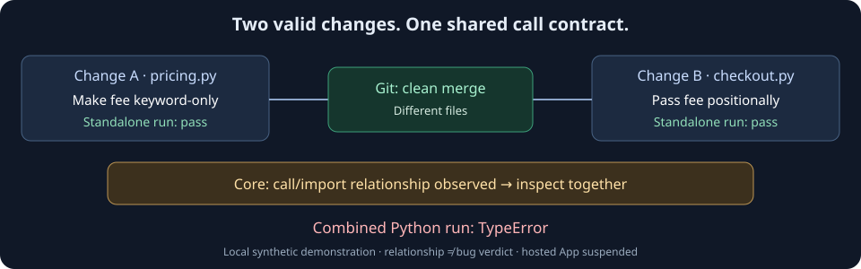

# Veripsa Core — 日本語の入口

**並行して進む変更が、同じ仕組みのどこでつながるかを調べる。**

一方の作業で関数の引数を変え、もう一方でその呼び出し側を直しているとします。変更するファイルが別なら、Gitがテキストの競合なくマージできても、組み合わせた実行が壊れることがあります。Veripsa Coreは、呼び出し・依存・設定・APIなどの構造から、一緒に確認する接点を取り出します。

作者は[RollNuts](https://github.com/RollNuts)です。開発の出発点は、Gitのコンフリクトを何度も解消する負担を改善したい、という困りごとでした。開発にはAIを利用しています。現在は販売を目的とせず、蓄積した技術を他の開発者が理解し、試し、検証できる状態へ整えています。[English README](../README.md)も参照できます。

**現在使えるものはローカルの解析・デモと公開ソースです。ホスト型GitHub Appは2026年8月18日から停止中です。** インストールによって現在のPRへCheckが出る、という案内ではありません。

## 最初の30秒：何を見る道具か



Gitは変更をテキストとして統合します。このデモでは、その結果と、Coreの静的な構造解析、Git履歴の同時変更、組み合わせたPythonの実行結果を並べて確認します。

| 読む順序 | 確認できること |
| --- | --- |
| 30秒 | 上の図で、別ファイルの変更にも接点があることを知る。 |
| 3分 | 下のローカルデモで、実際のマージと解析結果を比較する。 |
| 10分 | 設計上の判断、検出の限界、既存の履歴評価とMCP実験へ進む。 |

これは読む入口の目安で、実行時間のベンチマークではありません。

## 次の3分：GitとPythonだけで試す

Git、Python 3.12、POSIXシェルを使う手順です（macOS／Linux向け）。今回はmacOSで実測しており、Windowsでは検証していません。空の作業ディレクトリで実行します。

```sh
git clone https://github.com/RollNuts/veripsa.git
cd veripsa
python3.12 examples/structural-overlap/demo.py
```

cloneにはネットワークを使います。その後のデモはローカルで動き、追加パッケージ、アカウント、データベース、モデルAPIを使いません。一時ディレクトリ内に架空のGitリポジトリを作り、そこでマージするため、あなたの作業リポジトリをマージする操作ではありません。独自のGit実行ファイルが必要なら、`--git /path/to/git`を指定できます。

JSON出力の`cases`で、次の組み合わせを確認します。4ケースとも各branchの単独実行は成功し、Gitのマージもcleanになります。

| case | Code graph | Co-change | union | intersection | 統合後の実行 |
| --- | --- | --- | --- | --- | --- |
| `function_contract` | `observed` | `not_observed` | `observed` | `not_observed` | `TypeError` |
| `compatible_related` | `observed` | `observed` | `observed` | `observed` | 成功 |
| `unrelated` | `not_observed` | `observed` | `observed` | `not_observed` | 成功 |
| `dynamic_lookup` | `not_observed` | `observed` | `observed` | `not_observed` | `TypeError` |

Code graphは静的な構造上の関係、Co-changeは一緒に変更された履歴です。表の`union`はどちらかで観測された候補、`intersection`は両方で観測された候補を表します。JSONでは、それぞれ`relationship.status`、`cochange.status`、`combined.union`、`combined.corroborated`に対応します。

最初の例では、履歴が1commitしかなく、Co-changeの既定条件を満たしません。残りの3例は、14commitのうち対象2ファイルを6回一緒に変更する架空の履歴です。この実行では、既存producerの既定値である共同変更回数`co >= 5`、方向付き確率の大きい方である`strength >= 0.3`、`lift >= 2.0`を使います。条件はJSONの`cochange.parameters`でも確認できます。

動的な名前解決の接点は静的解析に出ませんが、この例では履歴から候補が出ます。一方、`unrelated`は機能上つながらないファイルを一緒に更新した履歴でも候補になる例です。Co-changeは共変更の記録であり、因果関係や将来の故障を保証しません。unionにするとこの4例すべてが候補となり、intersectionでは失敗する2例がどちらも候補から外れます。この小さい合成例から一般的な検出精度は算出しません。`not_observed`を「依存がない」「Clear」とも読みません。

デモ自体の終了コード`0`は、この期待した比較結果に一致したことを表します。統合後のすべての実行が成功した、という意味ではありません。`probes`には、既存のAPIルート・設定キー解析を使う小さい静的な確認も含みます。

[デモの手順・出力・限界](../examples/structural-overlap/README.md)と[期待出力](../examples/structural-overlap/expected-output.json)から、ケースと検査方法を追えます。このデモは既存の抽出器、オフライン評価器の粗い隣接関係、既存の`_cg_cochange.cochange_pairs`を利用しています。unionとintersectionはオフラインの候補集合の比較で、PostgreSQLのPR判定規則ではありません。Appには履歴の別枠advisoryと、特定の静的関係を裏付ける限定的な処理があります。[実装資産の整理](ANALYSIS_ASSETS.md#static-and-historical-evidence-complement-each-other)で区別しています。稼働中のGitHub Checkは検証せず、出力の`hosted_signal`は`not observed`です。

## 自分のrepoで、変更前に読むファイルを探す

Coreをcloneしたディレクトリから、次のコマンドで試せます。

```sh
python3.12 -B -m tools.review_file . _cg_cochange.py
python3.12 -B -m tools.review_file /path/to/your/repo src/example.py
```

2行目の引数は、自分のGitリポジトリのルートと、そこからの相対ファイルパスへ置き換えます。既存のコードグラフによる候補と、過去に一緒に変更された候補を別々に返します。Python入力では追加パッケージ・DB・モデルAPIは不要です。

解析できなかったファイル、短い履歴、shallow cloneなども出力します。候補が空でも「依存なし」「安全」とは判断しません。対象プロジェクトのコードを実行・編集せずに調べます。出力の読み方、`-B`が必要な理由、入力制限は[ローカルファイル調査の手順](LOCAL_FILE_REVIEW.md)を参照してください。

## 次の10分：設計と、別の問いを調べる

[研究資料の索引](RESEARCH_INDEX.md)から、設計・Code graph・Co-change・評価・セキュリティ研究・実例・限界・開発経緯へ進めます。既存の再現結果と、一般的な精度・処理時間・メモリなどの未計測事項を分けて確認できます。

試して分かった誤検出・検出漏れ・解析不備は、[参加ガイド](../CONTRIBUTING.md)と[解析報告フォーム](https://github.com/RollNuts/veripsa/issues/new?template=analysis_report.yml)から報告できます。最小再現や期待値の根拠、反例の提供も貢献です。脆弱性の疑いは[非公開の報告経路](../SECURITY.md#reporting-a-vulnerability)へ送ってください。

### 出発点と、今の目的

コンフリクトの負担を減らしたいという実際の困りごとに加え、作者は将来、複数のAIを並行して使う開発が増えると考えていました。その需要が目に見える形になるまでには、当時の見通しより時間がかかった、というのが作者の振り返りです。

MCPから使う案も当時からありました。エージェントからの呼び出しを入口にする使い方と、PR作成やpushを入口に継続して解析する使い方では、起動の役割が違います。Coreでは後者のためにGitHub Appのイベント処理を選びました。自動解析も、サービスが稼働し、イベントを正常に受信・処理できることが前提です。

現在は、製品の販売や再稼働を先に進めるのではなく、作ってきた実装と判断を技術資産として残し、RollNutsの仕事を知ってもらうことを目指します。[開発経緯の下書き](PUBLISHING_KIT.ja.md#背景記事の下書き)では、この目的と、後から実施する検証の結果を分けています。

### なぜ、関係をバグ判定にしないのか

構造上つながる変更にも、互換性を保った変更があります。今回の動的参照は、Code graphでは未観測でも、与えた履歴からCo-changeの候補になります。履歴にも、短い履歴では拾えないことや、偶然一緒に更新したファイルを拾う限界があります。Coreの出力は、次に何を一緒に読むかの材料です。実行の正しさは、組み合わせたコードとテストで調べます。

[設計と判断理由](../ARCHITECTURE.md)には、既存エンジンを再利用する理由、現在のheadに判断を結び付ける理由、解析時の読み取りと保存する情報の境界をまとめています。

### ソース本文を蓄積しない

Coreは解析時に本文を読むことがあります。保存・表示するのはファイルパス、シンボル名、構造上の関係、PRやcommitの識別情報、判断状態などです。ソース本文やdiff本文を蓄積する設計にはしていません。名前やパスも機密になり得るため、公開前の確認は必要です。[データの境界](../SECURITY.md#content-free-posture)を参照してください。

### Pythonの構造とGit履歴を比較する

既存の[Flaskによるオフライン評価例](OFFLINE_EXAMPLE.md)は、公開commitとPython環境を固定し、構造上の関係が過去の同時変更とどの程度対応するかを比較します。今回の小さいマージデモとは、測っている問いが異なります。

最初はPython標準ライブラリだけの経路を使えます。他言語や設定解析の一部には追加の解析依存が必要です。今回のPythonデモが動くことを、全言語の解析完全性やPRの安全性の証明にはしません。

### 開発の中で蓄積した技術を分けて見る

Coreから得られたものは、GitHub Appの画面や警告だけではありません。[Code graph・Co-change・永続化の実装資産一覧](ANALYSIS_ASSETS.md)から、既存コード、今回実行した検証、今後の提案を分けて読めます。

| 技術 | 現在追える入口 | 確かめる範囲 |
| --- | --- | --- |
| Code graph：コードの構造を取り出す | [抽出器](../code_graph_extract.py)、今回のローカルデモ | 構造上の接点として何が観測され、何が出ないかを確かめる。 |
| Co-change：履歴の同時変更を調べる | [既存producer](../_cg_cochange.py)、今回のデモ、[Flask例](OFFLINE_EXAMPLE.md) | 構造と履歴の候補を比較し、cold startと偶然の共変更を区別する。 |
| Persistence：状態と判断履歴を残す | [資産一覧の永続化の説明](ANALYSIS_ASSETS.md#what-persistence-buys)、[Appの構成](../ARCHITECTURE.md) | イベントやexact head、ACKなどを継続処理する層として、ローカル解析とは別に検証する。 |

これらは、開発を進める中で蓄積した実装です。現在の独立した用途は、コードの棚卸しと再現できる検証から説明します。App側のDBは、イベントや判断履歴を保持する層として残ります。DBなしの小さいデモと、DBを含む処理の検証は、それぞれ条件と結果を記録します。

### AIエージェントから問い合わせる

別repoにある[ローカルMCPアダプターの固定版](https://github.com/RollNuts/zenn-content/tree/89fe0fe12258c827a9e7fc54cb12fc96401018de/examples/core-local-mcp)では、保存済みsnapshotを`graph_summary`と`tauri_related_files`の2ツールから照会できます。最新Coreで公式Tauri例を抽出し、Codex CLIから問い合わせる実証も記録されています。

これは検討用アダプターで、製品版のCore MCPや、編集中の作業ツリーを自動追跡する機能ではありません。SDKだけの再現はモデルを呼びません。**任意のCodex手順にはログインとモデル利用枠が必要です。今回の無料ローカルデモには不要で、ここで実行を求めるものではありません。** Claude Codeへの常駐登録は、このデモで確認した範囲に含みません。

警告や候補を受け取ったAIエージェントが取れる行動は、例えば次の順序です。

1. 対象commitと解析の時点を確認する。
2. 名前が挙がったファイルやAPI契約を一緒に読み、変更の前提を照合する。
3. 互換性を保つ修正や取り込み順を提案し、組み合わせたテストを実行する。
4. 人間や既存のリポジトリ方針に判断を返す。

MCPアダプターには書き込み・マージのツールはありません。エージェント自身の他の権限は別に管理します。MCPが本文を返さなくても、そのメタデータをホストがモデルへ送る場合があります。

## 実装・作者・発信素材へ

- [GitHub Appとして実装されている範囲](PRODUCT_FACTS.md)：同じrepo内のopen PR、Check、PRコメント、ACKの意味。
- [作者の背景記事下書き・紹介文](PUBLISHING_KIT.ja.md)：困りごと、今回分かったこと、設計判断。外部への投稿は行っていません。
- [変更履歴](../CHANGELOG.md)：今回追加した検証用の入口。
- [RollNutsのGitHub](https://github.com/RollNuts)：他の公開作品と技術記事。
- [未発生新聞 / Mihassei](https://github.com/RollNuts/mihassei-news)：静的サイトとRSSを扱う別の公開作品。Coreとは別の目的です。

Coreのライセンスは[Business Source License 1.1](../LICENSE)です。再利用時は追加利用許諾と変更日を含め、条件を確認してください。
